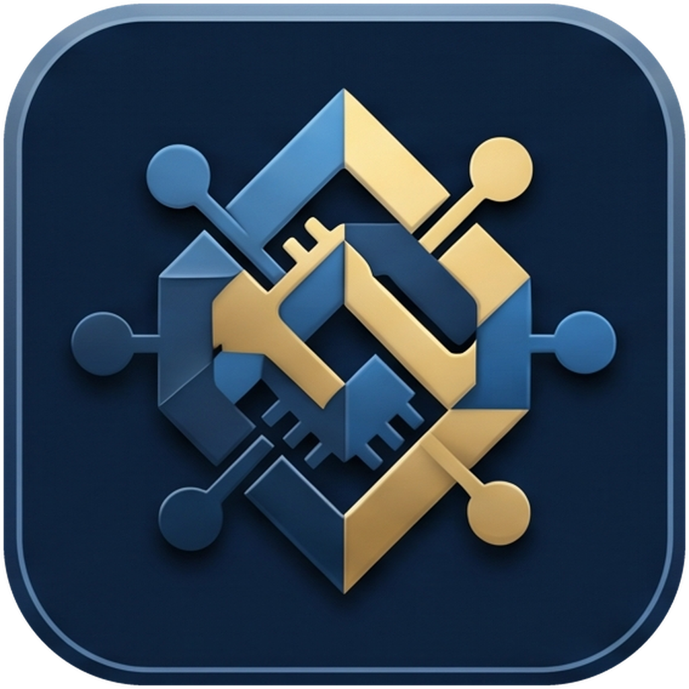

<p align="center">
  
</p>

<h1 align="center">Joinery</h1>

<p align="center">
  가볍고 빠른 데스크톱 데이터베이스 클라이언트<br>
  SQLite · PostgreSQL · MySQL · MariaDB — macOS · Windows · Linux
</p>

<p align="center">
  <a href="https://github.com/softkr/Joinery/releases/latest"><b>최신 버전 내려받기</b></a>
</p>

---

Joinery는 Go와 [Wails](https://wails.io)로 만든 단일 실행 파일 DB 클라이언트입니다. 테이블 탐색과 편집, SQL 에디터, ER 다이어그램, 백업·복원까지 한 창에서 처리하며, 별도 런타임이나 `pg_dump` · `mysqldump` 같은 외부 도구가 필요 없습니다.

## 주요 기능

- **데이터 그리드** — 페이징, 정렬, `WHERE` 필터, 셀 편집, 행 추가·삭제, 폼 보기, CSV / JSON 내보내기
- **SQL 에디터** — 테이블·컬럼 자동 완성, 선택 영역만 실행, 여러 문장의 결과를 탭으로 분리, 실행 중지, SQL 포맷, 쿼리 기록
- **테이블 설계** — 필드 · 인덱스 · 외래 키 편집, 저장 전 `SQL 미리보기`
- **오브젝트 탐색** — 테이블 · 뷰 · 인덱스 · 트리거 · 함수 · 프로시저, 정의(DDL) 보기
- **ER 다이어그램** — 드래그 배치, 자동 정렬, 테이블 찾기, SVG / PNG 저장
- **백업과 복원** — 서버에서 직접 만드는 이식 가능한 SQL 덤프, `.sql` 파일 실행
- **안전한 연결** — SSL/TLS, SSH 터널(`known_hosts` 검증), 비밀번호는 OS 키체인에 보관
- **편의 기능** — 명령 팔레트(`⌘K` / `Ctrl+K`), 키보드만으로 트리·탭 조작, 라이트/다크 테마

## 설치

[Releases](https://github.com/softkr/Joinery/releases/latest)에서 운영체제에 맞는 파일을 내려받습니다.

| 플랫폼 | 파일 | 참고 |
|---|---|---|
| macOS (Apple Silicon · Intel) | `Joinery-<버전>-macos-universal.zip` | 압축을 풀고 `Joinery.app`을 `응용 프로그램` 폴더로 옮깁니다 |
| Windows 10 / 11 (x64) | `Joinery-<버전>-windows-amd64.zip` | WebView2 런타임이 필요합니다 (Windows 11에는 기본 포함) |
| Linux (x64) | `Joinery-<버전>-linux-amd64.tar.gz` | `libgtk-3-0`, `libwebkit2gtk-4.1-0` 패키지가 필요합니다 |

내려받은 파일은 함께 올라간 `SHA256SUMS.txt`로 확인할 수 있습니다.

> [!NOTE]
> **macOS에서 처음 실행할 때** — 앱이 Apple 공증(notarization)을 거치지 않아 "확인되지 않은 개발자" 경고가 뜹니다.
> `시스템 설정 → 개인정보 보호 및 보안`에서 `그래도 열기`를 누르거나, 터미널에서 격리 속성을 지운 뒤 실행하세요.
>
> ```bash
> xattr -dr com.apple.quarantine /Applications/Joinery.app
> ```

## 시작하기

1. 사이드바 위쪽의 **새 연결** 버튼을 누릅니다.
2. 연결 유형을 고르고 접속 정보를 입력한 뒤 `연결 테스트` → `저장`.
3. 사이드바에서 연결을 더블클릭하면 데이터베이스와 테이블 트리가 펼쳐집니다.

바로 둘러보고 싶다면 저장소의 [`sample/demo.db`](sample/demo.db)를 SQLite 연결로 추가하세요. 고객 1,200명과 주문 · 상품 · 감사 로그 테이블, 뷰, 트리거가 들어 있습니다.

### 연결 옵션

| 항목 | 설명 |
|---|---|
| SQLite | 데이터베이스 파일 경로 (`찾아보기…`로 선택) |
| PostgreSQL / MySQL / MariaDB | 호스트 · 포트 · 사용자 · 비밀번호 |
| SSL / TLS | 연결 다이얼로그의 `SSL / TLS`. 인증서를 검증하는 모드에서는 CA 파일을 지정할 수 있습니다 |
| SSH 터널 | `SSH 터널`을 체크하고 호스트 · 사용자 · 비밀번호 또는 개인키를 입력합니다 |

SSH 호스트 키는 `~/.ssh/known_hosts`로 검증합니다. 처음 보는 호스트는 지문을 확인한 뒤 앱에서 바로 등록할 수 있고, 키가 바뀐 호스트는 항상 거부합니다.

PostgreSQL을 로컬에서 잠깐 띄워 보려면:

```bash
docker run -d --name pg-try -e POSTGRES_PASSWORD=pw -p 127.0.0.1:5432:5432 postgres:17-alpine
# 호스트 127.0.0.1 · 포트 5432 · 사용자 postgres · 비밀번호 pw
docker rm -f pg-try   # 다 쓰고 나서 정리
```

## 사용법

### 데이터

| 작업 | 방법 |
|---|---|
| 테이블 열기 | 트리에서 테이블 더블클릭. 기본 200행씩 페이징하며, 페이지 번호를 입력하고 `Enter`로 이동합니다 |
| 정렬 · 필터 | 헤더 클릭으로 정렬. 필터 창에 `city = '서울' AND vip = 1`처럼 `WHERE` 조건을 입력, 오른쪽 `×`로 해제 |
| 셀 편집 | 셀 더블클릭 → `Enter` 또는 바깥 클릭으로 저장, `Esc` 취소, `⌘/Ctrl+0`은 NULL |
| 행 추가 · 삭제 | 툴바 `행 추가` / `행 삭제`. `⌘/Ctrl+클릭`, `Shift+클릭`으로 여러 행 선택 |
| 폼 보기 | 툴바 `폼 보기` — 한 행을 세로 폼으로 보고 편집, 이전/다음 행 이동 |
| 셀 값 자세히 | 셀 우클릭 → `상세 보기…` (긴 텍스트, JSON 정렬). 헤더 경계를 드래그해 너비 조절, 더블클릭하면 내용에 맞춤 |
| 내보내기 | 툴바 `CSV` / `JSON` — 현재 필터와 정렬이 적용된 전체 행 |

### SQL 에디터

| 작업 | 방법 |
|---|---|
| 새 쿼리 | 연결이나 데이터베이스를 선택하고 사이드바의 `새 쿼리` 버튼. `customers.`처럼 입력하면 컬럼을 자동 완성합니다 |
| 실행 | `⌘/Ctrl+Enter`. 선택한 부분이 있으면 그 부분만 실행하고, 실행 중에는 경과 시간과 `중지` 버튼이 보입니다 |
| 여러 문장 | `SELECT 1; SELECT 2;`처럼 `;`로 구분하면 문장마다 결과 탭이 생깁니다 (오류가 나면 그 자리에서 멈춤) |
| 포맷 · 주석 | `포맷` 버튼 또는 `Alt+Shift+F` (선택 영역 우선), `⌘/Ctrl+/`로 주석 토글 |
| 쿼리 기록 | 에디터 툴바 `기록` — 검색, 에디터로 가져오기, 삭제, 기록 끄기 |

### 구조와 오브젝트

| 작업 | 방법 |
|---|---|
| 테이블 설계 | 테이블 우클릭 → `테이블 설계` — 필드 · 인덱스 · 외래 키 편집 → `SQL 미리보기` → `저장` |
| 새 테이블 | 데이터베이스 우클릭 → `새 테이블…`, 또는 사이드바의 `새 테이블` 버튼 |
| 오브젝트 창 | 데이터베이스 더블클릭. `목록 / 자세히 / 아이콘 / ER` 보기 전환, 이름 필터, 아래쪽 정보 창의 `일반` · `DDL` 탭 |
| 인덱스 · 트리거 · 함수 | 트리에서 그룹을 펼친 뒤 더블클릭, 또는 우클릭 `정의 보기` / `쿼리 편집기로 열기` |
| ER 다이어그램 | 보기 모드 `ER` — 박스 드래그, 휠로 확대·축소, 배경 드래그로 이동, `맞춤` / `재배치`, `테이블 찾기`, `SVG` / `PNG` 저장. 배치는 기억됩니다 |

### 백업과 복원

| 작업 | 방법 |
|---|---|
| 백업 | 데이터베이스(PostgreSQL은 스키마) 우클릭 → `백업 (SQL 덤프)…` — 테이블, 구조/데이터, `DROP … IF EXISTS`, 뷰 · 트리거 · 함수 · 프로시저 포함 여부를 고른 뒤 `.sql`로 저장 |
| 복원 | 데이터베이스(스키마) 우클릭 → `SQL 파일 실행 (복원)…` — 파일 선택 → 확인 → 실행한 문장 수와 오류 요약. 기본은 첫 오류에서 멈추며 `오류가 나도 계속 실행`을 고를 수 있습니다. 최대 256MB |

### 키보드

| 범위 | 단축키 |
|---|---|
| 전체 | `⌘K` / `Ctrl+K` 명령 팔레트 — 명령, 열린 탭, 펼쳐진 테이블, 저장된 연결 검색 |
| 트리 | `↑` `↓` 이동 · `→` `←` 펼치기/접기 · `Enter` 열기 · `Shift+F10` 메뉴 · `F5` 새로고침 |
| 탭 | `⌘/Ctrl+W` 닫기 · `Ctrl+Tab` 또는 `⌘/Ctrl+Alt+←/→` 전환 |

실행하지 않은 쿼리나 저장하지 않은 설계가 있는 탭은 제목에 `•`가 붙고, 닫기 전에 한 번 확인합니다. 테마는 상단 툴바 오른쪽의 달/해 버튼으로 바꾸며, 설정하지 않으면 시스템 설정을 따릅니다.

## 데이터 저장 위치

연결 목록과 쿼리 기록은 사용자 설정 폴더의 `dbcat` 디렉터리에 저장됩니다 (권한 0600).

| OS | 폴더 |
|---|---|
| macOS | `~/Library/Application Support/dbcat/` |
| Windows | `%AppData%\dbcat\` |
| Linux | `~/.config/dbcat/` |

`connections.json`에는 비밀번호가 들어가지 않습니다. DB와 SSH 비밀번호는 OS 키체인(macOS 키체인, Windows 자격 증명 관리자, Linux Secret Service)에 서비스 이름 `dbcat`으로 저장됩니다.

## 제약 사항

- **백업**은 `pg_dump` / `mysqldump` 없이 서버에서 직접 읽어 만든 SQL 스크립트입니다. 다음은 포함되지 않습니다.
  - PostgreSQL: enum 등 사용자 정의 타입, 확장(extension), 권한(GRANT), 소유자, 시퀀스 옵션(시작값 · 증가값 등. 현재 값은 `setval`로 맞춥니다)
  - MySQL / MariaDB: 이벤트, 권한, `DEFINER`(제거되므로 복원한 사용자 소유가 됩니다), 공간(geometry) 값의 정확한 표현
  - SQLite: 테이블 · 인덱스 · 뷰 · 트리거를 원본 `CREATE` 문 그대로 덤프합니다
- **복원**은 파일의 문장을 순서대로 실행할 뿐이므로, 파일에 `DROP`이나 `DELETE`가 있으면 기존 데이터가 지워집니다. 실행 전에 확인창이 한 번 뜹니다. MySQL `DELIMITER` 구문을 지원합니다.
- **필드 유형 · NULL · 기본값 변경**은 PostgreSQL만 지원합니다. SQLite와 MySQL에서는 이름 변경 · 추가 · 삭제만 가능합니다.
- **외래 키**는 PostgreSQL / MySQL에서 추가 · 삭제할 수 있고, SQLite에서는 새 테이블을 만들 때만 정의할 수 있습니다.
- **SQL 에디터 결과**는 문장당 1,000행까지 표시합니다. 테이블 데이터 보기와 내보내기는 전체 행을 다룹니다.

## 개발

필요한 것: Go (버전은 [`go.mod`](go.mod) 참고), Wails CLI v2.17.1. Linux에서는 `libgtk-3-dev`, `libwebkit2gtk-4.1-dev`도 필요합니다.

```bash
go install github.com/wailsapp/wails/v2/cmd/wails@v2.17.1   # 최초 1회

wails build                       # build/bin/Joinery.app (Windows: Joinery.exe)
go run . -web 127.0.0.1:8080      # 창 없이 브라우저로 실행 (루프백 주소만 허용)
go test ./...                     # 단위 테스트
```

| 플래그 | 설명 |
|---|---|
| `-web <주소>` | 네이티브 창 대신 루프백 HTTP로 UI 제공 |
| `-config <파일>` | 연결 목록 파일 경로 지정 |
| `-history <파일>` | 쿼리 기록 파일 경로 지정 |

SQL 에디터 번들(`web-src/editor`)을 고쳤다면 다시 빌드합니다.

```bash
cd web-src/editor && npm install && npm run build   # → internal/web/static/editor.js
```

실제 DB 서버가 필요한 통합 테스트는 환경 변수가 있을 때만 실행됩니다.

```bash
DBCAT_IT_PG=postgres:pw@127.0.0.1:15432 \
DBCAT_IT_MYSQL=root:pw@127.0.0.1:13306 \
DBCAT_IT_MARIADB=root:pw@127.0.0.1:13307 \
go test ./internal/db -run Integration -v      # MySQL / MariaDB에는 shop 데이터베이스가 있어야 합니다
```

### 프로젝트 구조

| 경로 | 내용 |
|---|---|
| [`main.go`](main.go) | 앱 진입점, Wails 창 설정, `-web` 모드 |
| [`internal/db`](internal/db) | DB 드라이버 추상화, 메타데이터, DDL, 덤프, SSH 터널 |
| [`internal/store`](internal/store) | 연결 목록 · 쿼리 기록 저장, 키체인 연동 |
| [`internal/web`](internal/web) | HTTP 핸들러, htmx 템플릿, 정적 파일 |
| [`web-src/editor`](web-src/editor) | CodeMirror 기반 SQL 에디터 번들 소스 |
| [`build`](build) | 앱 아이콘, macOS `Info.plist` |

## 릴리스

`v`로 시작하는 태그를 push하면 GitHub Actions([`release.yml`](.github/workflows/release.yml))가 테스트를 돌린 뒤 세 플랫폼을 빌드하고 Release를 만듭니다. 태그 이름이 앱 버전으로 들어갑니다.

```bash
git tag -a v0.2.0 -m "v0.2.0" && git push origin v0.2.0
```

태그에 `-`가 들어가면(`v0.2.0-rc1`) 프리릴리스로 올라갑니다. Actions 탭의 `release` → `Run workflow`로 Release 없이 빌드만 시험할 수도 있습니다.

## 라이선스

[MIT License](LICENSE)

| 서드파티 대상 | 라이선스 파일 |
|---|---|
| 바이너리에 링크된 Go 모듈 | [THIRD_PARTY_LICENSES.txt](THIRD_PARTY_LICENSES.txt) |
| UI에 번들된 JavaScript (htmx, CodeMirror, dagre 등) | [internal/web/static/THIRD_PARTY.txt](internal/web/static/THIRD_PARTY.txt) |
